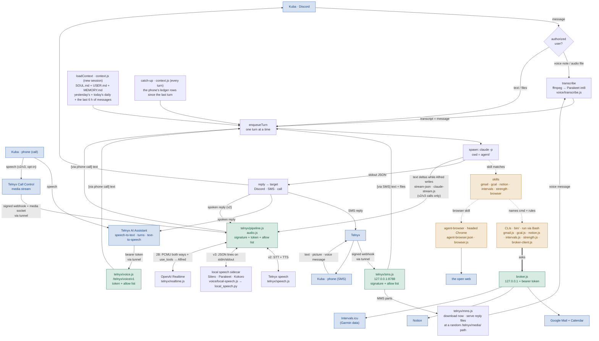
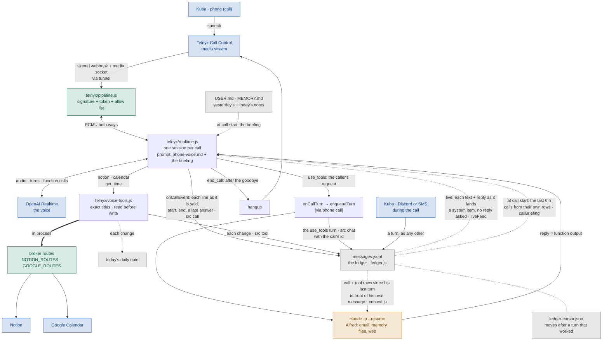
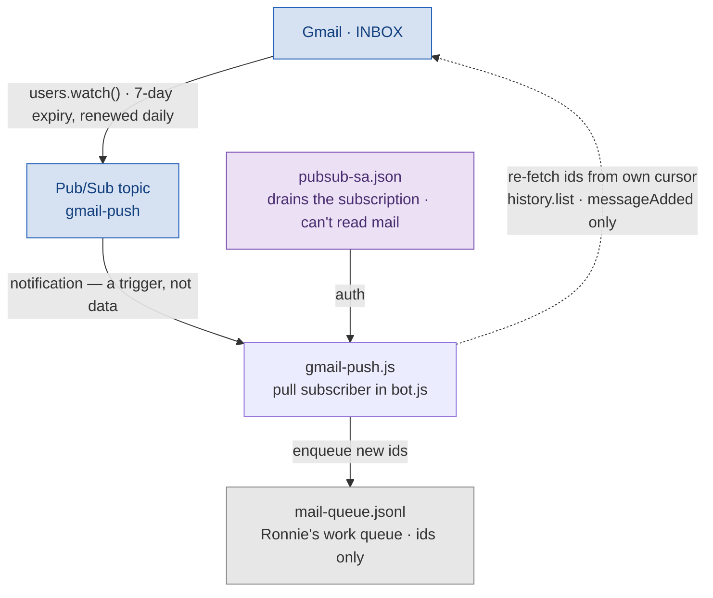
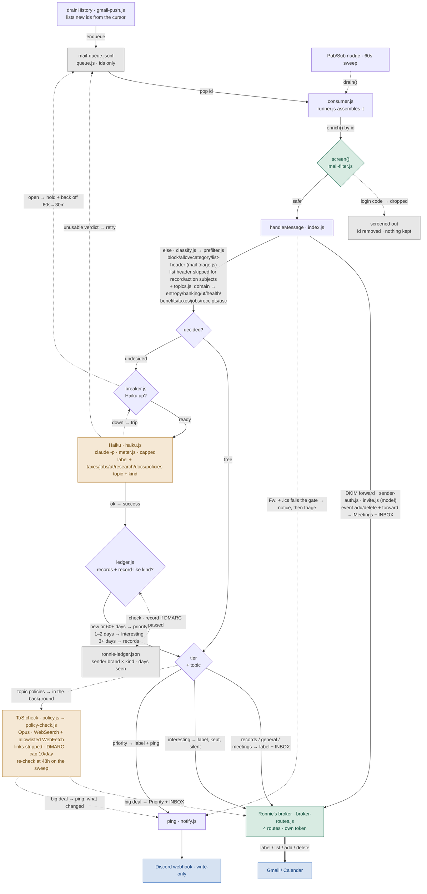
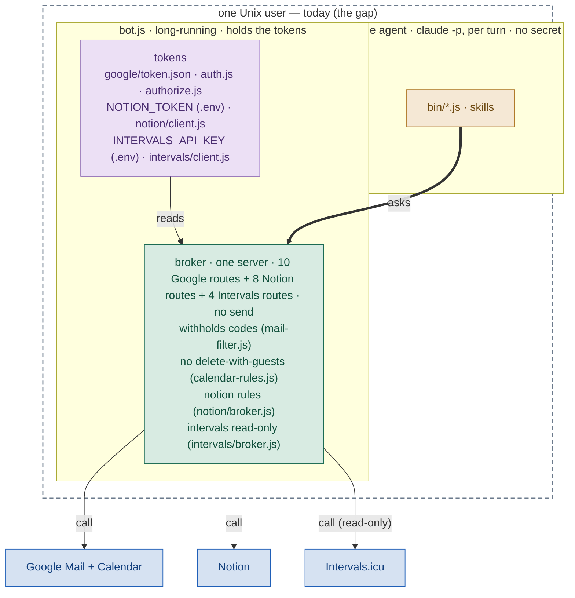
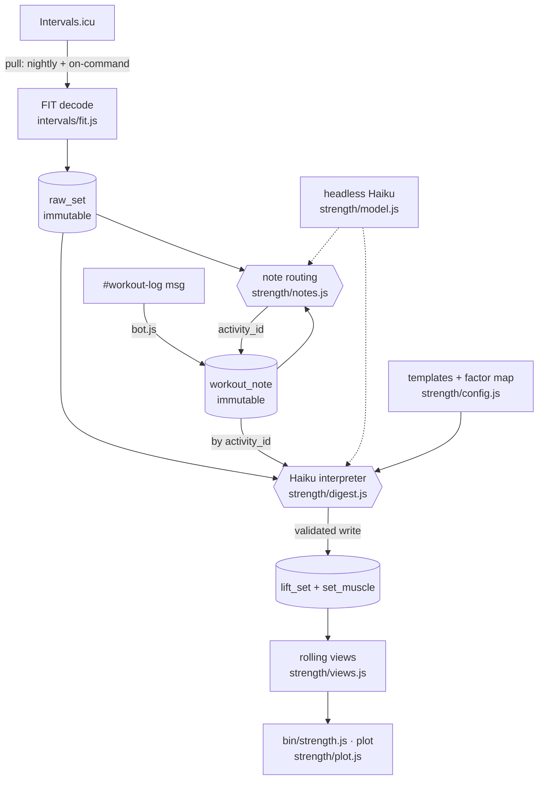
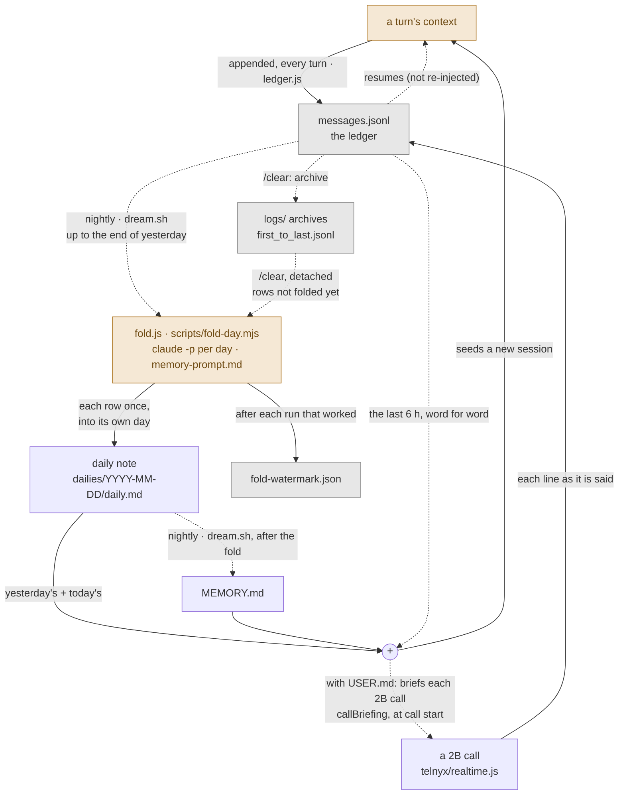

# System map

What Alfred is today — the reference for *"where would that change go?"* Plans
live in `TODO.md`. Update this in the same PR as a change *to the system it
draws* — dev-side work like tooling or these docs touches nothing here;
`npm run map:check` catches real drifting. Diagrams are Mermaid, so they diff as text.

This is the thing to point at when weighing how to build something: name where
on the map a change lands, and which boxes or arrows it adds, moves, or deletes.

---

## Reading this map

One grammar, consistent across every diagram — learn it once.

**Node colour = what a thing is.**

| colour | kind |
|---|---|
| blue | external service — Discord, Google, Notion |
| green | gateway — the broker, the one guarded way out |
| violet | a secret — a token at rest |
| sand | the agent — `claude -p`, its skills and CLIs |
| grey | an internal step or a store |

**Arrow = how strong the link is.**

| line | meaning |
|---|---|
| solid | flow, or a call that happens on the turn |
| thick | the one **guarded crossing** — the agent's authenticated request into the broker |
| dotted | indirect — conditional (on match, `/clear`), scheduled (nightly), or context-only (resume) |

**Structure, not colour, carries the trust boundary.** The dashed box in
Credentials is "one Unix user, today" — the gap we mean to split, drawn as a box
rather than a warning colour.

**A stack of cards means several of one kind, one per service** — skills and
CLIs each fan out to gmail / gcal / notion.

**One gateway is one box.** There is a single broker; its route table merges
every service. Never a broker per service.

**Say which links are guarantees.** A rule enforced in `bot.js` code — no send
route, withheld codes, no guest-deletes — is a guarantee no prompt can undo; a
rule that lives only in a skill body is guidance. Where the difference matters,
the map makes clear which kind it is (green is the guarantee colour).

---

## A turn

There is no Alfred between turns. `runClaude` spawns a fresh `claude -p`, it
answers, it exits.



A **voice message** is the one input that isn't its own text. It takes two
shapes, both meaning "the message is the audio": a native Discord voice note
(the `IsVoiceMessage` flag), or a lone audio file dropped in with no caption — a
voice memo recorded in another app. `voice/detect.js` decides (a caption next to
the audio keeps it a normal turn). `voice/transcribe.js` runs the file through
ffmpeg (→ 16 kHz mono) and the on-device Parakeet-TDT int8 model
(`voice/transcribe.py`, via onnx-asr) — audio is transcribed locally, never sent
out — and the transcript *becomes* the user message, so everything downstream is
blind to whether a turn was typed or spoken. The bot echoes `🎙️ heard: …` first,
so a mishearing is visible before the turn acts on it. Provisioned once by
`scripts/setup-voice.sh`; if it isn't set up, the note draws a graceful reply and
no turn.

**SMS** is the second way in. Telnyx posts each text to a webhook. A tunnel
(Tailscale Funnel) forwards the public URL to `telnyx/sms.js` on loopback. The
server rejects any request without a valid Ed25519 signature. It then drops a
text that is not from `SMS_ALLOWED_NUMBERS`. These two checks are code, so they
are guarantees. A text that passes runs the same turn as a Discord message, in
the same session, with a `[via SMS]` tag. The turn answers through a *reply
target*: Discord, SMS, or both. With `SMS_MIRROR_CHANNEL` set, that channel is
the phone thread: texts and replies show there, and a message typed there is
also answered by SMS.

An MMS works like a Discord message with files. `telnyx/mms.js` saves each
part at once, because Telnyx's links expire. A voice message (one audio file,
no words) is transcribed like a Discord voice note, and `🎙️ heard: …` is texted
back first. Files in a reply go back as MMS: Telnyx fetches each one from the
same webhook server, at a random `/telnyx/media/<token>/` path that lives for
an hour. That path is the only guard, like a presigned link.

**A phone call** is the third way in. A Telnyx AI Assistant answers the call.
Telnyx does the audio: speech-to-text, turn detection, interruption, and
text-to-speech. The assistant's model is `telnyx/voice.js`, on the same
loopback server as SMS. Telnyx sends each caller turn as an OpenAI-style
`/chat/completions` request with a bearer token. The route rejects a request
without the token, then refuses a caller not in `VOICE_ALLOWED_NUMBERS`. A turn
that passes runs in the same session with a `[via phone call]` tag. The reply
streams back as text, and Telnyx speaks it. If the caller talks over a reply,
the next turn tells Alfred that they did not hear it.

**A phone call over the v2 pipeline** is opt-in and runs next to v1. The phone
number's setting in the Telnyx portal decides which path answers. Telnyx Call
Control posts a signed `call.initiated` to `telnyx/pipeline.js`, which answers an
allowed caller with a media stream. Telnyx opens a WebSocket back to the same
loopback server. The upgrade needs a secret token in the URL and an Ed25519
signature over that URL. `telnyx/speech.js` sends the caller audio to Telnyx
speech-to-text (Deepgram Flux). Flux decides the end of a turn, and the turn
runs the same `onCallTurn` as v1. The reply goes to Telnyx text-to-speech one
sentence at a time. `telnyx/audio.js` converts it to 8 kHz mu-law, and it goes
back over the socket. If the caller talks over it, the pipeline clears the audio
and the next turn tells Alfred.

**Option 2B** (`VOICE_PIPELINE_ENGINE=openai`) is the same Call Control path,
but `telnyx/realtime.js` sends the caller audio to one OpenAI Realtime session
per call, as PCMU with no transcoding. OpenAI decides the end of a turn and
talks. For Alfred's tools, memory or actions, it calls the `use_tools`
function, which runs the same `onCallTurn` as v1. Its reply goes back as the
function output, and the speech model says it. Its prompt is
`agent/phone-voice.md`, with a briefing of the recent past after it. On a
barge-in, the pipeline clears the audio and truncates the item at the point
the caller heard.

**The v3 pipeline** is the same path with the speech on this machine
(`VOICE_PIPELINE_ENGINE=local`, the default of the pipeline). bot.js starts one
Python sidecar (`voice/local_speech.py`) through `voice/local-speech.js`. The
sidecar keeps Silero voice detection, Parakeet and Kokoro in memory. It decides
the end of a turn (a silence timer), transcribes the turn, and speaks each
sentence. Caller audio does not leave the machine. If the sidecar stops, the
client starts it again. If the caller talks again within 1.5 s of a turn, the
pipeline cancels that turn and sends its words with the next one.

**Streamed replies.** For a pipeline call, `runClaude` runs `claude -p` with
`--output-format stream-json`, and `claude-stream.js` reads the text deltas
from its stdout. The pipeline speaks each sentence while Alfred still writes
(`VOICE_STREAM_REPLY`, on by default). The final "result" line is the same as
json mode, so the session, the log and the mirror post do not change. Every
other turn keeps `--output-format json`.

The `bin/` CLIs are **never loaded into context** — the agent's tools are only
`Bash,Read,Edit,Write`, and it *runs* the CLIs as subprocesses. `SOUL.md` (always
injected) names them; a matching skill body adds the rules `--help` can't express
(Eastern time, colour categories, "withheld means stop"). So the chain is:
instructions name a command → the agent runs it via `Bash` → the CLI asks the
broker. The CLI is downstream and executed, not a thing that sits in the prompt.

The **browser** is the one reach that skips the broker. `agent-browser` (an npm
dependency) drives Google Chrome with a window: on the desktop when one is
there, else on an Xvfb screen that agent-browser starts itself. Chrome must be at
`/opt/google/chrome/chrome`, because Ubuntu's AppArmor allows the Chrome sandbox
only there. `agent/agent-browser.json` holds the static settings. The profile
and screenshots go under `agent/var/`. `browser.js` puts `node_modules/.bin` on
`PATH`. Chrome uses `--password-store=basic`, so its cookies do not depend on
the desktop keyring, which is not there after a reboot. The browser holds no logins. "Look, don't act" is
a rule in the skill body only, so it is guidance, not a guarantee.

The spawn, in full — the token reaches the agent through the environment, never
disk:

```sh
claude -p "<user message>" \
  --output-format json \
  --allowedTools Bash,Read,Edit,Write \
  --dangerously-skip-permissions \
  --resume <sessionId>
# cwd = agent/    env: ALFRED_BROKER=<loopback url>  ALFRED_BROKER_TOKEN=<per-boot secret>
#                      PATH=node_modules/.bin:…
```

## A phone call (2B)

Option 2B splits a call between two minds. The **voice** is one OpenAI Realtime
session per call: it hears, decides when the caller has finished, and talks.
**Alfred** is the same `claude -p` turn as Discord, reached only through the
`use_tools` function. The voice starts each call with `agent/phone-voice.md`
and a briefing of what it should know already (below); Alfred resumes his
session as usual. Quick work skips
Alfred: `telnyx/voice-tools.js` gives the voice its own notion, calendar
and get_time tools, run in process on the broker's route table — no
HTTP hop and no token, but the same guarded routes.



**One caller turn.** The voice decides which path: answer itself (small talk,
or something already said in this call), a direct tool, or `use_tools`. A
direct tool returns in under 2 s and the voice says the result. `use_tools`
takes a full Alfred turn (8 s or more), so the voice says a short line first;
the reply comes back as the function output and the voice says it in its own
words. Barge-in clears the audio and truncates the voice's item where the
caller stopped hearing it.

**Who knows what.** Alfred's next turn, on any channel, starts with what was
said and done on the phone since his last turn: the call's lines word for word,
and each direct-tool change (the catch-up in `context.js`). He is never
surprised by an edit he did not make. On the call it was Alfred too, so the
block says "you said (on the call)" and names no other assistant. A cursor
file, `agent/var/ledger-cursor.json`, keeps his place in the ledger. It moves
only after a turn worked, and only past the rows that turn read. So a restart
or a failed turn loses nothing, and `/clear` sets it back to the start. A
`use_tools` turn is a turn too, so it carries the call so far: Alfred reads the
caller's own words next to the request. Each direct-tool change also goes in
today's daily note.

The other way, **while a call is live**: each message Kuba sends by Discord or
SMS, and Alfred's reply to it, goes into the call as it is written (the live
feed, `liveFeed` in `context.js`). The ledger is also an in-process emitter;
the call subscribes as it starts and stops as it ends. Each row becomes one
`conversation.item.create` system item ("Meanwhile, by text, the user said:
…", "You replied by text: …"), with no `response.create`, so the voice knows it
from the caller's next turn and never speaks up about it. It is not a
`session.update`, which would replace the instructions and their cached prefix.
The call never gets its own rows (`via: "call"`). A file is named by its kind,
never sent: until Alfred's reply says what a photo shows, the item tells the
voice not to guess and to ask `use_tools`, which waits for that reply. `/clear`
tells the call to forget earlier context. Items pushed before the session is
set up wait for it. `VOICE_OPENAI_LIVE=0` turns the feed off.

**As a call starts**, its prompt is `phone-voice.md` and then a headed
background block (`callBriefing` in `context.js`, the `buildInstructions`
option of `realtime.js`): `USER.md`, `MEMORY.md`, yesterday's and today's daily
notes, and the last 6 hours of the ledger on every channel. Earlier calls come
from their own rows, never their `use_tools` turns, so a call shows once, and
Alfred's text replies are "you said (by text)": one persona again. A file is
named by its kind. The block says it is background: what it says needs no
tool, anything to look up or change still does. It is built while the OpenAI
socket connects and awaited before the `session.update`, at most 1 s; a
failure or a late one is logged, and the call starts with the plain prompt.
The budget is about 24,000 characters: the prompt, USER, MEMORY and the last
call stay whole, each note keeps at most its last 4,000 characters, and the
oldest messages go first, with a log line. A live update for a row that the
briefing tells already is dropped. `VOICE_OPENAI_BRIEFING=0` turns it off.
`docs/shared-context.md` has the whole picture.

**The call in the ledger.** The call writes itself into `messages.jsonl` as it
happens, not at the end: each caller line as transcribed, each voice line as
spoken, the start, the end with its length, and an answer that came back after
the hangup (`src: "call"`, with the caller and the call's id; `callRow` in
`ledger.js`). Each direct-tool change is a `src: "tool"` row. Only what the
caller heard is a line: the text of a silent tool chain never is, the
still-working filler is left out, and a line the caller talked over says how
much of it they heard. The `use_tools` turns stay chat rows (`via: "call"`,
the same call id), because Alfred's session already holds them. So the ledger
has a call twice, in two wordings, and a reader shows it once: from its own
rows, leaving out the turns that retell them (`retoldByCall`). With
transcription off, the requests stay, since the caller's words are not there.
The fold and a new session's recent messages read the ledger this way. The
catch-up reads only the call and tool rows.

**Guarantees here.** The allow list, signature and token checks in
`pipeline.js`, and the broker's own rules (no guest-deletes), are code. In
`voice-tools.js`, exact-title page lookup and "read before write" are code too.
Everything about how the voice talks is the prompt, so it is guidance.

**Testing it without a phone.** `scripts/voice-eval.mjs` holds scripted calls
with the same session code: `voice-eval/openai-call.js` stands in for Telnyx's
media stream, `voice-eval/fakes.js` for Notion, the calendar and Alfred (the
real `voice-tools.js` runs on top), `voice-eval/scenarios.js` holds the callers
and their checks, and `voice-eval/score.js` scores each call. Each test call
has its own ledger in a temp dir, fed into the call by the bot's `liveFeed`, so
a scenario can send a text mid-call by the same code. That dir is the call's
state dir too: a scenario's briefing world (USER, MEMORY, the notes, earlier
rows) is written there, and the bot's `callBriefing` builds the call's prompt
from it. Dev-only: nothing in the running bot imports it. See
`docs/voice-eval.md`.

## Inbound mail (Pub/Sub)

The second way something enters the system. Gmail publishes a change
notification, `bot.js` pulls it, re-reads the new message ids from its own
cursor, and enqueues them for Ronnie (next section). No Alfred turn runs, and no
content rests here — this path stores ids only. Mail arriving decides what Ronnie
does; it never causes a turn.



Three properties this path is built to hold, each matching a way it fails silently
if you get it wrong (`TODO.md` spells out the failure modes):

- **The notification is a trigger, not data.** Its payload is never trusted; on
  each nudge we re-read `users.history.list` from *our own* stored cursor
  (`agent/var/google/gmail-sync.json`, its own writer — never `state.json`). A
  lost or duplicated notification costs nothing, because the next drain still
  sees everything since the cursor.
- **`messageAdded`-only history** is what stops a phone-side "mark all read" from
  flooding the queue with mail that isn't new — label churn is filtered out at
  the source, not coalesced after. This path stores only ids, so the credential
  screen runs downstream in the consumer (see Ronnie), before anything is read.
- **Two credentials, two jobs** (see below). Reaching the *mailbox* is OAuth as
  the user; draining the *subscription* — our own cloud resource — is a service
  account (`agent/var/google/pubsub-sa.json`), which by construction cannot read
  mail. A stale cursor 404s → resync to the current historyId, and the mail in
  the gap stays in Gmail for a search to find; an expired watch just goes quiet →
  the daily renewal is what keeps it alive.

Ronnie is the only consumer of this path. Without it, `startMailListener` does
not start — inbound mail stays in Gmail, unread and safe, and nothing is lost.

## Ronnie — inbound-mail triage (tier 2)

The Pub/Sub path above enqueues new mail ids. Ronnie is the consumer that
*acts* on them as they land — but still, no Alfred turn runs. The drain no longer
processes mail inline: it **enqueues the new message ids** into a durable work
queue, and a separate consumer pulls from it, triages, and removes an id only
once it's handled. Gmail holds the content; the queue holds only ids, so nothing
loses mail across a crash or an outage. Ronnie decides; `bot.js` executes through
a broker of Ronnie's own. This is "tier 2" in `TODO.md`.



Seven properties, each a decision made on purpose:

- **The queue is the durable to-do list** (`queue.js`, `mail-queue.jsonl`). It
  holds message **ids only** — no body or subject ever rests there, so the
  codes-on-disk worry disappears (there's nothing in an id to redact). The drain
  enqueues (dedup by id, so a re-listed drain after a crash can't double-queue);
  the consumer removes an id only once it's genuinely handled. One process both
  enqueues and consumes, serialized through an in-memory mutex.
- **The credential screen is upstream of triage, unchanged** (green — the same
  guarantee as the read path). The consumer runs `screen()` right after the fetch
  and before triage, so a login code is dropped — the id leaves the queue and
  nothing is kept — and Ronnie, and Haiku, never see it. A "verify"/"sign-in"
  notice that trips that filter is withheld too; making those *ping* is a change to `mail-filter.js`,
  the shared chokepoint, not to Ronnie.
- **Haiku down trips a circuit breaker, not a retry storm** (`breaker.js`). Two
  consecutive `claude -p` failures and it opens: the queue piles up untouched and
  the cooldown grows exponentially (60s → 30 min), letting one probe through each
  time; any success closes it and the backlog drains. Only a *service* failure
  (`HaikuDownError`) does this. An unusable verdict (`UnparseableVerdictError`) is
  a one-message problem: the message is retried, never pinged. A poison message
  that keeps throwing is surfaced as priority (a ping) after 3 tries and dropped,
  so one bad message can't wedge everything behind it. (A failure used to fall
  back to priority; in the backfill that made 26 of 103 pings errors.)
- **Two paths, invite first.** A forward from one of Kuba's own addresses that
  passes DKIM/DMARC (`sender-auth.js`) is the *only* thing that reaches the
  calendar routes. Past that gate a Haiku pass (`invite.js`) reads the forward —
  prose body or `.ics`, it doesn't care — and returns add / delete / none; an add
  is deduped by *reading* the day and letting the model judge a match, then
  created with the same gcal insert `bin/gcal.js` uses; a delete finds and removes
  the matching event; none (a bare REPLY, ordinary mail) falls through to triage.
  Anything that fails the gate — a forgery, a stranger's attachment — falls
  through too. The auth check *is* the licence; a prompt-injected invite can at
  worst create a junk event, announced and undoable. After the calendar work —
  add, remove, or "already there" — the forward itself is labelled **Meetings**
  and archived, best-effort, so it does not sit in the inbox unlabelled.
- **The paid step runs last and rarely.** `prefilter.js` decides for free in
  order — blocklist, allowlist, Gmail's own category (Promotions/Social → filed;
  Updates/Primary go on), then a list-header (`mail-triage.js`). The list header
  files mail as General only when the subject has no record or action words
  (payment, statement, receipt, failed, action required, `Re:`/`Fwd:`, …): banks,
  tax sites and job portals put list headers on those too. Only what's left
  `undecided` spends one Haiku call (`haiku.js`), the way Alfred runs Claude —
  subscription, no API key. `meter.js` logs every call to `ronnie-usage.jsonl` and
  estimates cost at official token rates; past a daily **call** cap Ronnie
  surfaces the rest as priority and posts a one-time notice. Haiku sorts into
  five tiers: **Records**, **General** and **Meetings** are *moved* (the label +
  `removeLabels: ["INBOX"]` is the archive); **Interesting** is labelled but kept
  in the inbox, silent; **Priority** is labelled, kept, and *pinged* with Haiku's
  one-sentence why (`notify.js`).
- **A ToS email gets a web check** (`policy.js`, `policy-check.js`). When Haiku
  tags an email `policies`, it is filed as Haiku said, and a separate Opus run
  starts in the background, one at a time. It is the only Ronnie call with tools:
  `--tools "WebSearch,WebFetch"`, WebFetch allowed only for fixed research sites
  (`x` and `*.x` per site, since a rule is one exact host) plus the sender's
  domain when DMARC passed and the owner listed it, and `--permission-mode
  dontAsk --permission-prompts none`, so Claude Code refuses anything else; a
  redirect off the allowlist is refused too. The email reaches it through
  `stripLinks`, and the run doesn't start if `findLinks` still finds anything.
  The verdict is JSON (`--json-schema`), validated, with sources kept only on
  allowed hosts. Big deal → Priority, back in the inbox, ping with what changed.
  Every ToS email is checked again 48 hours later from a small id-only queue in
  `agent/var/ronnie-policy.json`, drained by the same sweep as the mail queue.
  Gated on DMARC, one company per 3 days, and 10 runs a day.
- **Every model call runs in a small box** (`claude-run.js`). Ronnie's `claude -p`
  calls read untrusted email, so each one runs from an empty temporary directory
  with only `PATH` and `HOME` in its environment, a hard timeout, and four flags:
  `--restricted` (the owner's settings run in `auto` mode, which let an unflagged
  call read files and run shell), `--strict-mcp-config`, `--disable-slash-commands`
  and `--no-session-persistence` (a saved session would keep the email body under
  `~/.claude/projects`). Haiku's own argv adds `--tools ""`. Model-written text
  posted to Discord goes through `stripLinks` (`strip-links.js`) first, because
  Discord makes a URL in an embed clickable.
- **The novelty ledger moves a routine-looking record up when it isn't routine**
  (`ledger.js`, `agent/var/ronnie-ledger.json`). Haiku also names the *kind* of mail
  (statement, autopay, payment confirmed, transfer, deposit, payment failed, …).
  For a records verdict of a record-like kind, the ledger looks up the sender's
  brand (registrable domain, with aliases such as gs.com → marcus.com) × kind:
  never seen, or last seen 60+ days ago → **Priority**, with the why as the ping
  text (a first autopay, a yearly charge); seen on 1–2 earlier days →
  **Interesting**; 3+ days, or again the same day → **Records**. Failed payments,
  bills due and security mail are never record-like, so the ledger can't make
  them routine. A sighting is recorded only when DMARC passed, so a spoofed email
  can't teach it that a sender is routine. `scripts/ronnie-ledger-seed.mjs` seeds
  it from backfill history (the date comes from the Gmail id, the kind from the
  subject).
- **Attention is five tiers; topic is a second axis nested under it**
  (`topics.js`, `labels.js`). The parent is the tier: **Priority** (interrupt now
  — the only tier that pings — kept in the inbox), **Interesting** (keep + read
  later, silent, kept in the inbox), **Records** (receipts, statements, payment
  and autopay confirmations, ToS updates — archived), **General** (noise —
  archived; the label was named Bulk and kept its id), **Meetings** (appointment
  mail and forwarded invites — archived). Priority, Records and Meetings are
  created by name at boot when their env id is unset. A topic is a child *under*
  the tier, so the same mail is **Priority/Banking** (a fraud alert),
  **Records/Banking** (a statement), or **General/Banking** (a rewards blast);
  Meetings has no topic children, and each tier lists the topics it carries
  (`TIER_TOPICS`); a topic a tier doesn't list falls back to the bare tier.
  `entropy`, `banking`, `health`, `benefits`, `receipts` and `usc` are
  deterministic sender-domain rules only — matching a domain **or any subdomain**
  of it, since banks and boards mail from subdomains (`usc` uses an exact-domain
  entry, `=sc.edu`, so people at USC never match) — and are never the model's to
  assert, so injection can't forge them. `taxes`, `jobs` and `ut` have domain
  rules too, and Haiku may also tag them, plus `research`, `docs` and `policies`,
  from the same verdict. A domain rule wins over Haiku's guess, except that
  Haiku's `research` beats the `usc` rule. Two cross-axis rules: `taxes` is always Interesting or
  Records (never a ping, never General), and a job **board** is a listing
  (**General/Jobs**) while an active thread is **Interesting/Jobs**. The child-label ids are resolved (and created if missing) by
  NAME at boot (`labels.js` → `google/gmail-labels.js`, the one spot allowed to
  *create* labels; the live broker can only apply ids that already exist). A
  one-time `scripts/ronnie-backfill.mjs` relabels the existing inbox through these
  exact primitives — dry-run report first, then `--apply` — Haiku-budgeted,
  resumable, migrating old flat `jobs`/`taxes` labels onto the tree, and never
  labelling withheld credential mail.
- **A second broker — the one deliberate exception to "one gateway."** Credentials
  below says one broker, never one per service; Ronnie is the exception, and it's
  per *principal*, not per service. Ronnie is a different actor than Alfred with a
  strictly smaller reach — the same `broker.js` server started with `baseRoutes:
  {}` and only `RONNIE_ROUTES` (`broker-routes.js`, 4 routes: label a message,
  and list / add / delete calendar events — the same three the gcal CLI uses, no
  edit), on its own port with its own token. It **cannot** read mail, send, or
  touch Alfred's 18 routes — the trust boundary is the route table, made physical.

**Two Discord-side controls**, both caught in `bot.js`'s reader and run *without*
a turn (no `claude -p`): an `undo cal:<eventId>` / `undo mail:<id>` reply — the only
Discord→Ronnie action path — calls Ronnie's broker to delete the event Ronnie added
or re-file a mistaken ping as general; and `/ronnie-metrics` runs `scripts/ronnie-dashboard.mjs`
over `ronnie-usage.jsonl`, posts a self-contained HTML cost dashboard, and drops it in
today's daily folder for Alfred to surface. Both are gated on Ronnie being configured.

Turning Ronnie off (drop the config) collapses this whole section. Ronnie is the
only mail consumer, so `startMailListener` does not start — inbound mail stays in
Gmail, unread and safe, and nothing is lost.

## Credentials

Two boxes because there are two processes. `bot.js` runs continuously and holds
the Google and Notion tokens; it **spawns** the agent per turn as a child that
holds no secret and can only *ask*, over loopback.



**One broker, not one per service.** It is a single HTTP server inside `bot.js`
— one port, one bearer token — whose route table merges Google's and Notion's
operations (`startBroker({ extraRoutes: NOTION_ROUTES })`). It is *not* the CLIs:
those are the clients in the agent box and hold nothing. The token is what the
agent lacks, so it asks the broker across the guarded crossing (thick), and the
broker reads a token and makes the authenticated call. The broker's rules run in
`bot.js`, so **no prompt can talk them out of firing**. (The one exception is
Ronnie's own 3-route broker — see the Ronnie section: a second gateway *per
principal*, not per service, so Ronnie's reach is a strict subset of Alfred's.)

**The gap is the dashed box.** Both processes share one Unix user today, so
`Bash` in the agent can read the tokens directly — around the broker, not
through it. Giving each box its own user splits the dashed box in two, and the
crossing becomes the only way across; "run the agent as a separate user" in
`TODO.md` is that change.

Notion follows the same shape as Google, one service over: `notion/client.js`
holds the one API call and the pinned API version, `notion/broker.js` the routes,
and `notion/blocks.js` / `notion/props.js` the markdown↔block and typed-property
conversions every read and write passes through. Its boundary is enforced
differently, though — not by a withheld OAuth scope but by **per-page sharing**
on Notion's side: the integration sees only pages explicitly connected to it, so
an unshared page isn't restricted, it's absent. `set` (a property overwrite) and
`edit` (a body-line overwrite) are the irreversible writes — Notion keeps no
API-reachable history — so those routes read the old value first and report the
`from → to`, the only undo there is. A block `remove` is the opposite: it lands
in Notion's Trash and is recoverable, so it's the safe kind of delete. Whole-page
delete and comments stay unwired.

Intervals.icu is the same shape again, but the simplest case: `intervals/client.js`
holds the one API call (HTTP Basic on `INTERVALS_API_KEY`) and `intervals/broker.js`
the three routes — `activities`, `activity`, `wellness`. It's where Alfred reads
Garmin data, which reaches Intervals.icu by Garmin Connect sync. Its boundary
isn't a scope or a sharing rule but the **method**: the client exposes GET and
nothing else, so the read-only guarantee is structural — there is no write route
to omit because there is no write path to reach, the same way mail has no send
route. Lists window to the last 30 days and project a curated field set, so a
query can't pull an account's whole history into the transcript.

### Strength load (Garmin lifting)

A subsystem on top of Intervals.icu: it turns Garmin strength workouts into a
rolling per-muscle load. The data Intervals.icu's JSON hides — reps and weight —
lives in the original FIT file, so this reads that instead.



The layers mirror the design in `docs/strength-load-design.md`. The SQLite store
(`strength/db.js`, at `agent/var/strength.db`, gitignored) holds the schema and
the config seed; `strength/ingest.js` walks the activity window and lands each
workout (lifting → `raw_set`, else the cardio table). A digest first runs
`strength/notes.js` — one model call routes every pending free-text note to the
session it describes and records the placement on `workout_note` — then
`strength/digest.js` runs a headless Haiku over each workout's raw sets (reading
its routed note by `activity_id`) to write the interpreted `lift_set`, applying
the muscle factor map itself so the numbers stay exact. Both model steps share
the spawner in `strength/model.js`. `strength/views.js` derives the 7-/28-day
ACWR and 14-day trend; `strength/plot.js` renders the figure Alfred sends. The
pull needs the key, so it runs broker-side through the `fit-sets` route
on-command, and in-process via `strength/nightly.js` (from `dream.sh`) overnight.
The `strength` skill and `bin/strength.js` are Alfred's read surface (the latter
also maps a new exercise via `exercise add`); the DB itself is local state, so
those reads don't cross the broker. The one thing the broker still gates is the
FIT download and decode.

## Memory

Every turn appends to the live transcript, `messages.jsonl`, which resumes into
the next turn — the tight loop. `ledger.js` owns that file. It writes each row
with a ts later than the one before, archives the file on `/clear`, and reads
it back (only the last bytes, one Eastern day, or the rows after a byte
offset). Append and archive take one lock, so a row that arrives during an
archive lands in the new file. The offset reader takes the lock too, so it
never misses a row that an append started before it. It is also an emitter:
`subscribe()` hears each row as it is written, in file order, and each archive
(the live feed into a 2B call). An inbound
row names the files saved with it (`files`, paths from `agent/`), so a fold can
open a photo that the words do not describe. Every row names its channel
(`via`), and a row's `src` says what wrote it: a chat turn, or a 2B call's own
lines and tool changes, written as the call goes (see "The call in the ledger"
above).

**Every day with messages gets a daily note.** `fold.js` folds each ledger row
into the note of its own Eastern day, one time. Two runs do it:

- At 3 AM, `dream.sh` first runs `scripts/fold-day.mjs --nightly`: every row
  not folded yet, up to the end of yesterday. Then it dreams.
- On `/clear`, `consolidateMemory` starts the same script, detached, for the
  rows of the new archive that no nightly pass folded.

Each run is one `claude -p` per day (cwd `agent/`, Read/Write/Edit, the prompt
in `memory-prompt.md`) that merges the day's transcript into its note.
`agent/var/fold-watermark.json` records how far folding got. It moves only
after a run worked, so the next run tries a failed day again. That includes the
rows of a `/clear` archive whose fold failed: every run also reads the archives
that hold rows after the watermark. A lock file keeps the nightly fold and a
`/clear` fold from folding the same rows at once.

`/clear` (and its `/c` alias, parsed in `commands.js`) is a **prefix**, not a
bare word: alone it clears and waits, but `/c <text>` clears and then runs
`<text>` as the fresh session's first turn — one message both resets and asks.
The transcript is archived *before* that message is logged, so the command never
lands in either the old note or the new one. Day boundaries — the per-day note
folders drawn below and the 3 AM cron — all key on Eastern through one helper,
`dailies.js`, so "today" means the same day everywhere.



The `+` is `loadContext` (`sessionContext` in `context.js`). A new session is
seeded with `MEMORY.md`, the daily notes of yesterday and today, and the
messages of the last 6 hours on every channel, word for word. A new session
holds none of them: it starts after `/clear`, or after a dream pass, when
yesterday's evening chat is in no session. The notes cover the days, and the
messages cover the hours that no fold has reached yet. Over 24,000 characters,
the oldest messages go first. A call shows once, from its own lines. The
dotted arrow is the resumed session — it carries the prior turns as context
but re-injects nothing. A 2B call starts from the same sources: its briefing
(`callBriefing`) is `USER.md`, `MEMORY.md`, the two notes and the last 6 hours,
built for the voice and kept to about 24,000 characters (see "A phone call
(2B)" above). `docs/shared-context.md` covers the ledger, the fold, the
catch-up, the live feed and the briefing in one place.

Two stages, decoupled in time. The fold does transcript → daily note, every
night and on `/clear`. The dream does daily note → `MEMORY.md`, every night
after the fold. Both are LLM-selective, not mechanical copies
(`memory-prompt.md`, then `dream.sh`). `MEMORY.md` seeds every new session, so
anything reaching it is re-read forever — which is why promotion is strict.

**Past days.** Before the fold, only `/clear` wrote a note from the chat, and it
put the whole conversation into the note of the day of the `/clear`.
`scripts/backfill-dailies.mjs` folds the archived days into their own notes, on
request. It needs an explicit state dir (`--state-dir`, for a copy, or
`--real-state`) and has a dry run. It reads only the rows up to the
watermark's `start`, the ones the fold does not own, and never moves the
watermark. Nothing runs it on a schedule.

## Layers

Kept apart on purpose. `bot.js` resolves all three from its own module path, not
from cwd.

| path | holds | in git? |
|---|---|---|
| repo root | the app + dev process — `bot.js`, `google/`, `notion/`, `intervals/`, `strength/`, `bin/`, `test/` | yes |
| `agent/` | Alfred's config — `SOUL.md`, `memory-prompt.md`, `agent-browser.json`, `.claude/skills/` | yes |
| `agent/var/` | Alfred's state — memories, transcripts, `state.json`, tokens | **never** |

Skill discovery walks *up* from `agent/`, so a `.claude/skills/` at the repo
root would load into Alfred too. Keeping the root free of one is what makes
"Alfred never reads the dev layer" true.

## Cron jobs

Two entries, and that's the whole of what runs on a schedule.

| when | runs | does |
|---|---|---|
| `@reboot` | `tmux` session `alfred-bot` → `start-alfred.sh` | supervisor: holds a lock so only one runs, waits for DNS, rotates the log, keeps `bot.js` up — restarts on crash with 5s→300s backoff |
| `0 3 * * *` (3 AM daily) | `dream.sh` | folds the ledger into each day's note (`scripts/fold-day.mjs`), then consolidates yesterday's note into `MEMORY.md` |

The supervisor restarts on **crash only** — a healthy process keeps running the
code it started with until something kills it or the box reboots. That once hid
a week of missing Google access; see "Say which code is actually running" in
`TODO.md`.

## The check

Hand-written on purpose — a generated map draws every arrow and so says nothing
about which ones matter. `npm run map:check` verifies it's *accurate*, not that
it's complete: it flags anything on disk that was never drawn, anything drawn
that's since been deleted, a wrong route count for either broker (Google and
Notion are counted separately, since each is a distinct reach), and a
`.claude/skills/` at the repo root. Not in the pre-commit hook — a diagram
lagging one commit isn't worth blocking a commit.
